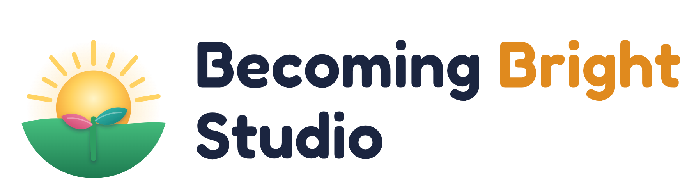

# Becoming Bright Studio

<p align="center">
  <picture>
    <source media="(prefers-color-scheme: dark)" srcset="brand/png/wordmark-dark.png">
    
  </picture>
</p>

<p align="center"><b>Every day a little brighter.</b></p>

**Short lessons that explain themselves, one skill at a time, for children aged 4 to 12. The child chooses the skill.** It works in the browser
and does not block other apps. Everything stays on the family's device: no accounts, no tracking.

- **Install:** https://ciaosiyoku.github.io/becoming-bright-studio/install.html (steps for your device, QR code)
- **Open the app:** https://ciaosiyoku.github.io/becoming-bright-studio/

> **Version 1, in testing.** It has passed its automated tests and been clicked through in a browser, but no child
> has used it yet ([docs/CHILD-TEST.md](docs/CHILD-TEST.md)). German, French and Yoruba have not yet been read
> aloud by native speakers.

The original [Kids' Learning Studio](https://github.com/Oluwasedago/kids-learning-studio) by Oluwasedago was a
strong shell with a weak lesson. This version puts **the lesson first, and a Settings page that doesn't pretend to
be a lock.** The games, radio, stories, fables, videos and explore items are back around the lesson, each Off,
Open or **Earn first**. The earlier version is kept in the
[`v0-full-shell`](https://github.com/ciaosiyoku/becoming-bright-studio/tree/v0-full-shell) tag.

## One session, one skill

Written down before any code in the [learning contract](docs/LEARNING-CONTRACT.md):

1. **Teach card:** one picture or number line, one sentence, read aloud.
2. **Two guided tries:** the child answers, then sees the right answer and a one-line reason. These don't count.
3. **Five checks:** one try each, then the reason. **4 of 5 means mastered**: the skill becomes a tree on the home
   screen, and the next one of the same subject is suggested.

After every answer, the right one turns green and the reason stays on screen until the child taps **Next**, which
unlocks after a moment. Nothing moves on by itself, so red never means "go faster".

**344 skills for ages 4 to 12, and the child chooses.** A grown-up gives each child an age; the child sees the
skills for their age range (4–5, 6–7, 8–9, 10–12), picks a subject, then a skill on that subject's path of
stepping stones. **Continue** on the Learn tab goes straight back to the skill they were learning. Every subject has **at least 300 different questions per age range** and **at least 15 skills per age range** (some shared with the range next to it; tests check both).

- **Maths (32):** counting; adding and taking away within 5, 10, 20, 100 and 1000; one more and one less; tens
  and ones; times tables; hours, minutes and seconds; place value; rounding; dividing; multiplying; fractions;
  percentages; order of operations; square numbers.
- **English (47):** letters and first sounds up to idioms, the passive and Greek and
  Latin roots.
- **Patterns (37):** picture patterns and number sequences.
- **Science (40, in every app language):** 10 per age range, from my body and the senses to body systems, evolution
  and circuits.
- **French (40, taught in English):** 10 per age range, from greetings and colours to the passé composé.
- **Verbal reasoning (51, in English):** the odd word out, word pairs and analogies, letter codes.
- **Quantitative reasoning (45, in English):** missing numbers, number machines, number stories (to 10, 20 and 100;
  times, sharing and prices).
- **Qualitative reasoning (52, in English):** reasoning about qualities: the odd picture out, which is biggest, fastest,
  heaviest, hottest or oldest, and which word describes three things.

Numbers are made fresh each time so answers can't be learnt by heart. Science, French and the newer English skills
are hand-written question banks. A test checks that every question, and every teach card's example, has **exactly
one right answer** in every language shipped.

## What the child sees

- **Sunny,** a friendly sun, says hello, explains each teach card and cheers right answers (a calm smile instead,
  if the grown-ups prefer).
- **Today's goal:** a few passed lessons a day (the same number the grown-ups set to open Earn-first items; 2 at
  first), with dots that fill in.
- **A garden:** every skill learnt grows a tree, its fruit in the subject's colour.
- **Stars** for every right answer in a lesson, and **100 stickers** in a sticker book, each with its own picture, all won by
  learning: first trees in each subject, trees grown, days in a row, lessons finished, stars collected, 5 of 5,
  every skill of a subject for the child's age. The sticker book shows the ones won first.
- **Subject cards** with a progress bar ("3 of 15 learnt"), and a **skill path** of stepping stones for each subject.
- **Streaks:** days in a row with a lesson, and the best streak.
- **Soft sounds** for taps, right answers and a finished lesson (a miss never buzzes), and small pops and bounces
  (calm instead if the grown-ups choose, or if the tablet asks for reduced motion).
- Stories heard, fables read and Whys read get a tick.

## Around the lessons

| Tab | Items |
|---|---|
| **Games** | Memory, Word builder, Code breaker, Picture puzzle, Number slide, and thinking games with levels: Mini sudoku, Tower of Hanoi, Repeat the pattern, Picture logic |
| **Listen and watch** | Children's radio (live: Die Maus, Fun Kids, Mon Petit France Inter, Babyradio, Kids FM 101.7 Lagos from Nigeria and Radio Nursery from Canada), Stories (at least 50 per age range, LibriVox, public domain), **Fables** (50 per age range, read aloud by Mary or Barry, each with its lesson to think about first), Videos (a checked library from official channels) |
| **Explore** | Places of the world (real photos with credits), 500 Whys, Did you know? |

The grown-ups set each subject and each item to **Off**, **Open** or **Earn first**. An earn-first subject opens for
the day after a set number of passed lessons (2 at first). With Earn first, a passed lesson earns minutes
(10 at first, up to 45 a day), and the clock at the top shows what's left.

**Fables:** 200 short fables, 50 per age range, old public-domain tales (Aesop; the Panchatantra, Jataka and folk
tales from India; Anansi stories from Ghana; tales from Nigeria and West Africa; La Fontaine; the Brothers Grimm; Hans
Christian Andersen; tales from Russia, China and Japan; folk tales such as *The Three Little Pigs*), retold for this
app in our own words. They get longer and richer with each age range: very short ones for ages 4–5 (*The Tortoise and the
Hare*, *The Lion and the Mouse*), up to fables to discuss for ages 10–12 (*The Lion-Makers*, *How Anansi Brought the
Stories*). Each fable plays as a **little animated film**: one scene per paragraph, the animals it names moving on a
stage that shows the place it describes (running, hopping, flying, swimming, falling, sleeping), while Mary or Barry
reads it and the word being read lights up. Pause, go back or skip at any time; without a voice the scenes move on at
reading pace. Then the child thinks and taps **What is the lesson?** The scenes are made from the words
(`src/media/scenes.ts`), so every fable is animated, including new ones. They are in English.

**Stories play like the fables,** read by their human LibriVox readers: while a recording plays, the scene for the
part being read is on the stage and its words are shown underneath, with buttons to jump to the part before or after.
The words are the books' public-domain texts from Project Gutenberg (`public/stories/`, one file per book), matched to
177 of the 272 recordings; where the time falls in the text is estimated from the paragraphs' lengths, so a scene can
change a few seconds early or late. Recordings without a matching text (Uncle Wiggily on the Farm, Thirty More Famous
Stories Retold, most of the German tales) show one scene made from their title.

## Settings (for grown-ups)

- **Behind a PIN,** the **Settings** button at the top. Settings opens on a card per section, in the style of the
  Learn tab: a picture, the name, and what it is set to now; a card that needs a look (a backup is due, recovery
  details are missing) has an amber ring. Tap a card to open it; Back goes to the cards, then out.
- **Sections:** a **learning report** per child (today, 7 days, 30 days: lessons, passed, checks right, skills
  learnt, time per area, questions to practise again, Send by email); children; what your child can open (Off /
  Open / Earn first for every subject and item, lessons to pass, minutes per lesson and per day); language; reading
  voice; sounds and movement (sound effects, Sunny's cheers, lively or calm); backup; the PIN; and **Update now**.
- **PIN:** stored as a salted hash. A **recovery code** is shown once at setup, with a Print button, and the grown-up
  adds an **email address and a secret word**. A forgotten PIN needs the code plus the email or the secret word (all
  stored only as hashes; nothing is sent). There is no 24-hour reset: without them, the way back is starting again
  from a backup (backups never hold the PIN, the code, the email or the secret word).
- **Backup** in one file, with an automatic reminder once a week.
- **Several children** on one device: each with a name, a colour and their own progress. One PIN for the family.
- **Updates:** the app checks for a new version once a day and loads it between activities, never in the middle
  of a lesson or a video. **Update now** fetches it straight away.
- **Reading voice:** Mary (female), Barry (male) or Off. The voices come from the device; when it has none of the
  chosen kind, the nearest voice reads a little lower or higher, so Mary and Barry never sound alike.
- **Languages:** English, Deutsch, Français, Yorùbá. The English lessons stay in English.

## What it is not

- Not a lock. Keeping a child in one app is a device setting (Guided Access on iPad, App pinning on Android). A
  bedtime or home-screen lock would be a native app, a later product.
- Not a video app: a small, checked library only, behind a setting in Settings. No ads of our own.
- No server and no accounts.

## For contributors

Node 22+, Vite, React, TypeScript, Vitest.

```sh
npm install        # once
npm run dev        # the app at http://localhost:5173 (install page: /install.html)
npm test           # unit tests, including every question of every skill in every language
npm run lint
npm run build      # the finished site in dist/
```

Every push to `main` is checked, built and published to GitHub Pages by `.github/workflows/deploy.yml`.

| Where | What |
|---|---|
| `docs/LEARNING-CONTRACT.md` | Who it's for, one session, what the parent sees, what it won't do, the session on paper |
| `docs/CHILD-TEST.md` | How to test a skill with one child, and what to change for what you see |
| `src/skills/*.json` | One file per skill: its words in each language and its question maker |
| `src/skills/generate.ts`, `numbers.ts`, `words.ts`, `reasoning.ts` | The question makers and teach cards |
| `src/lesson/` | The session (teach, guided, checks) and its screen |
| `src/parent/` | PIN, recovery code, Settings |
| `src/skills/bank.ts` | Question banks (science, French, newer English skills); `scripts/bank-example.py` sets each bank's teach example |
| `src/games/` | Memory, word builder, code breaker, picture puzzle, number slide, and the thinking games (levels in `levels.ts`) |
| `src/media/` | Radio, stories, fables (`fables/`, one file per age range), the animated scenes (`scenes.ts`, `Stage.tsx`), the story texts' timing (`storyText.ts`), videos |
| `public/stories/` | The story recordings' texts (Project Gutenberg, public domain), one file per book |
| `src/explore/` | Places of the world, 500 Whys, Did you know? |
| `src/home/`, `src/app/stickers.ts` | The Learn tab: Sunny, today's goal, the garden, subject cards, the skill path; the 100 stickers |
| `src/skills/ages.ts` | Age ranges; `ages.test.ts` checks 300 questions per subject and range |
| `scripts/make-stories.py` | Builds the stories list per age range from the Internet Archive |
| `src/app/items.ts`, `access.ts` | The items of each tab, Off / Open / Earn first, earned time |
| `src/parent/report.ts` | The learning report (pure, tested) |
| `src/i18n/` | Every sentence, one file per language |
| `src/app/state.ts` | The one document saved on the device (one IndexedDB key) |

**Adding a skill:** add a JSON file to `src/skills/` (copy one of the same kind, give it the next `order`), then run
`npm test`. The app picks up every file in that folder. **Adding a language:** copy `src/i18n/en.ts`, add the skill texts, and have a native speaker read every
child-facing sentence aloud first.

## Credits and licence

Code: [MIT](LICENSE), based on Kids' Learning Studio by Oluwasedago. Logo: original, drawn by
`scripts/make-brand.mjs` ([brand/](brand/README.md)). Pictures: [Microsoft Fluent Emoji](public/emoji/CREDITS.md)
(MIT). Place photos: Wikimedia Commons, free licences ([credits](public/photos/CREDITS.md)). Stories: LibriVox
(public domain). Fables: public-domain tales, retold in our own words. Story texts: Project Gutenberg (public domain). Fonts: Andika and Fredoka (SIL Open Font License).
