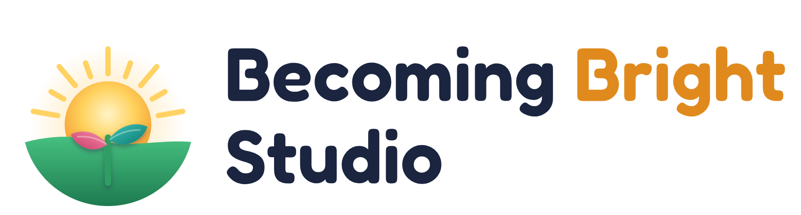

# Becoming Bright Studio

<p align="center">
  <picture>
    <source media="(prefers-color-scheme: dark)" srcset="brand/png/wordmark-dark.png">
    
  </picture>
</p>

<p align="center"><b>Every day a little brighter.</b></p>

Becoming Bright Studio is a free learning home screen for children aged about 4–10. Parents install it from a
browser link on an Amazon Fire, Android tablet or iPad. Each day brings a few short missions. Stars from missions
earn screen time, mistakes come back until they are understood, and a learning garden grows as skills are mastered.
Everything stays on the family's own device: no accounts, no tracking, no server.

**The idea behind the name.** Learning is a sunrise. It doesn't happen all at once: it grows a little each day.
The logo shows that moment. A night-blue sky warms into dawn, the sun comes up over the hill, and a young sprout
opens two leaves, coral for the child and teal for the parent who helps it grow.

Based on [Kids' Learning Studio](https://github.com/Oluwasedago/kids-learning-studio) by Oluwasedago (MIT), with
the improvements listed below.

> **Status: in development.** Usable for testing. The Yoruba translation is a draft (beta) for a native speaker
> to check, and several items still need checking on real devices (see [ROADMAP.md](ROADMAP.md)).

## Try it

```sh
npm install
npm run dev        # the app at http://localhost:5173, the demo at http://localhost:5173/?demo (parent PIN 1234)
```

Publishing on GitHub Pages: push to a repository named `becoming-bright-studio` and turn on Pages
(Settings → Pages → Source: GitHub Actions). The included workflow builds and publishes every push to `main`.
Then the install page is `https://<your-github-name>.github.io/becoming-bright-studio/install.html`
(steps for each device, with a QR code). See [INSTALL.md](INSTALL.md).

## How a child grows brighter

- **Short daily missions.** Rounds of 10, 25 or 50 questions (the parent chooses) in maths, English, the world and
  patterns. 70 % right passes and earns a star per 10 questions. Lessons follow the child's school class
  (Cambridge, England, US, Germany or Nigeria) on a ladder of 58 skills up to Stage 6, and adapt: two strong rounds
  move up a step, a weak round moves down.
- **Mistakes become lessons.** After a wrong answer, the right one turns green with the sum worked out and a reason
  where there is one ("The ones digit is 4: less than 5, so round down to 30"). The question then goes into the
  **review boxes** and comes back tomorrow, then after 3, 7 and 21 days, until it is known (spaced practice, the
  Leitner system). Up to a fifth of each round is these "Try again" questions.
- **Answers that can't be guessed.** From Stage 1, every other number question is answered on a number pad.
- **A learning garden.** Every skill practised is a seedling on the Learn screen; it becomes a tree once known.
  It shows learning growing for its own sake, not only stars and minutes.
- **A learning streak.** Days in a row with a passed mission, with streak freezes and milestones.
- **Stars earn time.** Each star unlocks minutes for games and videos, up to a daily limit the parent sets.
- **Games:** memory, word builder, picture puzzle, snake and code breaker.
- **Media:** children's radio, classic stories read aloud (public domain), a video library from official channels
  and live animal cams, and YouTube videos a parent adds. **Family calls:** one tap to call someone.
- **Library and world map:** real photos of 40 animals and 40 famous places; tap any country on the map for its
  flag, capital, people, languages and money.
- **Four languages:** English, Deutsch, Français and **Yorùbá (beta)**. The English lessons stay in English.

## For parents

- **Two layers of control:** every item can be hidden, and every visible item is either open or earned (locked
  until missions are done). A parent can unlock something for today with the PIN.
- **Reports** for a day, week or month: active days, stars, minutes, **how well each skill is known**
  (Known / Practising / Needs help), questions waiting in the review boxes, questions learnt from mistakes, and
  recent wrong answers. Sent from the parent's own mail app.
- **Settings for how it teaches:** show the answer and why after a mistake (on by default) or keep it hidden;
  typed number answers on or off.
- **Safe PIN:** stored only as a salted hash. Wrong tries are remembered even if the pad is closed or the app
  reloaded, and the wait grows after each 5 wrong tries (30 s, 2 min, 10 min, 30 min). A recovery code or a 24-hour
  reset handles a forgotten PIN.
- **Clock-change guard:** turning the device clock forward used to give a fresh day of screen time. Now, when the
  clock goes back past a time the app has already seen, earned time pauses and the parent screen explains why.
- **Backup and restore** in one file. Backups from Kids' Learning Studio restore here too.

## What changed from Kids' Learning Studio

| Area | Change |
|---|---|
| Learning | Review boxes (spaced practice) for every wrong answer; the right answer and why after a mistake; typed number answers; the level follows new questions only |
| Motivation | Learning garden on the Learn screen |
| Reports | Skill mastery for the last 30 days; review-box figures |
| Security | PIN lockout kept across closing and reloading, with growing waits; device-clock guard |
| Language | Yoruba (draft): app, lessons, facts, places, animals, map, code breaker |
| Fix | A right answer now turns green (there was no style for it) |
| Brand | New name, logo (sunrise and sprout) and theme |

Download size was measured and left as it is: the main script is about 150 KB compressed. Splitting it by language
or screen would save little (all four languages are about 12 KB compressed), and the offline cache only keeps files
that have been opened, so a split-off part would be missing offline.

## Privacy

Everything the child does is saved only on the device (in the browser's own storage). There are no accounts,
no analytics and no adverts. The app contacts other services only when the child plays something from them: the
radio station's stream, the Internet Archive for stories, and YouTube for videos. Reports leave the device only
when a parent sends them from their own mail app.

## Credits and licences

- Code: [MIT](LICENSE). Original project: Kids' Learning Studio by Oluwasedago.
- Logo: original artwork, MIT with the code ([brand/](brand/README.md)); drawn by `scripts/make-brand.mjs`.
- Pictures: [Microsoft Fluent Emoji](public/emoji/CREDITS.md) (MIT). Photos: [Wikimedia Commons](public/photos/CREDITS.md),
  free licences, credited in the app. Fonts: Andika and Fredoka (SIL Open Font License).
- Stories: LibriVox recordings (public domain) via the Internet Archive. Radio: Die Maus (WDR), Fun Kids,
  Mon Petit France Inter (Radio France), Babyradio. Details: [docs/CONTENT.md](docs/CONTENT.md).
- World map: [Natural Earth](https://www.naturalearthdata.com/) (public domain); population:
  [World Bank](https://data.worldbank.org/) (CC BY 4.0); country facts:
  [mledoze/countries](https://github.com/mledoze/countries) (ODbL); flags: [flag-icons](https://github.com/lipis/flag-icons)
  (MIT); Yoruba country, language and money names from the browser (Unicode CLDR). Details: [src/maps/data/SOURCES.md](src/maps/data/SOURCES.md).

## For contributors

You need [Node.js](https://nodejs.org) 24 or newer.

```sh
npm install        # once
npm run dev        # the app at http://localhost:5173 (install page: /install.html)
npm test           # unit tests (including every lesson question in every language)
npm run lint       # code checks
npm run build      # the finished site in dist/
```

Before your first commit, turn on the privacy check (it blocks private words and secrets):

```sh
git config core.hooksPath .githooks
cp .private-words.example.txt .private-words.txt   # then list your own family's names, school, etc.
```

Where things are: `src/lessons` (skills ladders, review boxes in `review.ts`), `src/missions`, `src/progress`
(stars, streak, learning garden), `src/access`, `src/games`, `src/media`, `src/parent`, `src/reports`, `src/data`
(storage, backup), `src/i18n` (every text, per language), `brand/` (logo). How it fits together:
[docs/product-map.html](docs/product-map.html).
